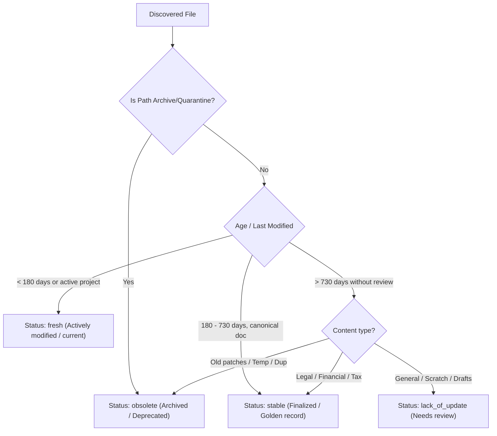

# 03 — Document Lifecycle & Validation Classification

## 1. Classification Objectives

Unmanaged storage environments decay over time because files lack explicit validation states. Files that are 5 years old often sit in writable operational folders without context on whether they are authoritative agreements or obsolete drafts.

`gdrive-data-hub` assigns every document one of four lifecycle states:

```
  ┌─────────────────────────────────────────────────────────────┐
  │                    LIFECYCLE STATES                         │
  ├───────────────────┬─────────────────────────────────────────┤
  │ fresh             │ Actively modified or created (< 180 d)  │
  │ stable            │ Finalized golden record / immutable     │
  │ lack_of_update    │ Unreviewed for > 365 d in active domain │
  │ obsolete          │ Superseded, deprecated, or temporary    │
  └───────────────────┴─────────────────────────────────────────┘
```

---

## 2. Decision Logic & Transitions



### Definitions & Actions:
1. `fresh`:
   - High priority for indexing and immediate daily search.
   - Surfaced in active workspace summaries.
2. `stable`:
   - Marked as immutable reference baselines.
   - Protected against accidental deletion.
   - Used as ground-truth verification anchors when validating incoming documents.
3. `lack_of_update`:
   - Tagged with `review_due_date`.
   - Surfaced on the Management Portal dashboard to alert the owner to review or revalidate terms.
4. `obsolete`:
   - Excluded from primary AI context generation to prevent models from hallucinating on outdated terms or superseded policies.
   - Safely quarantined or archived in `07_ARCHIVE/`.
